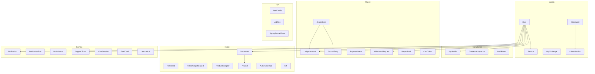
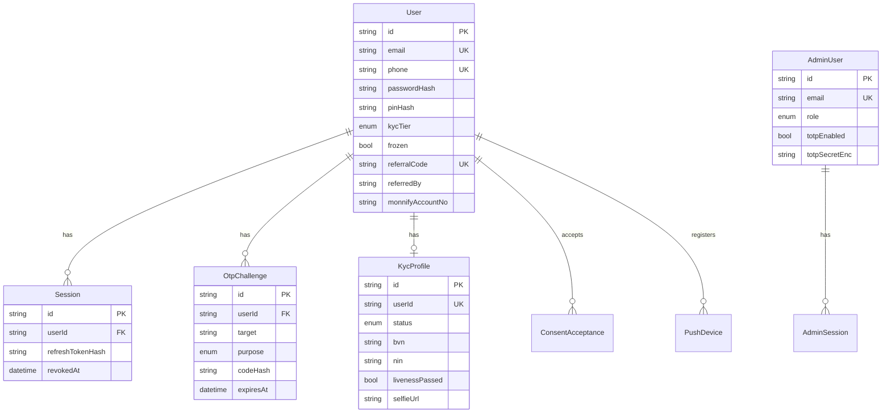
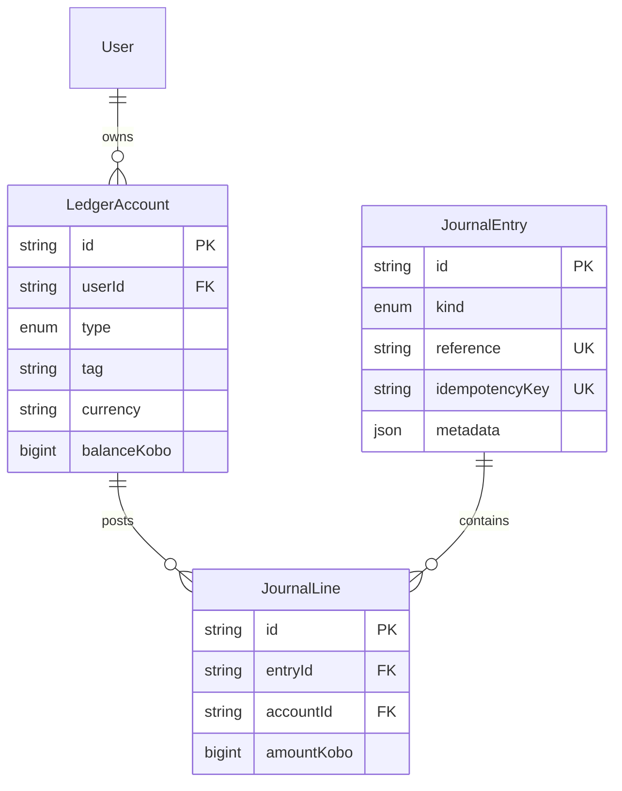
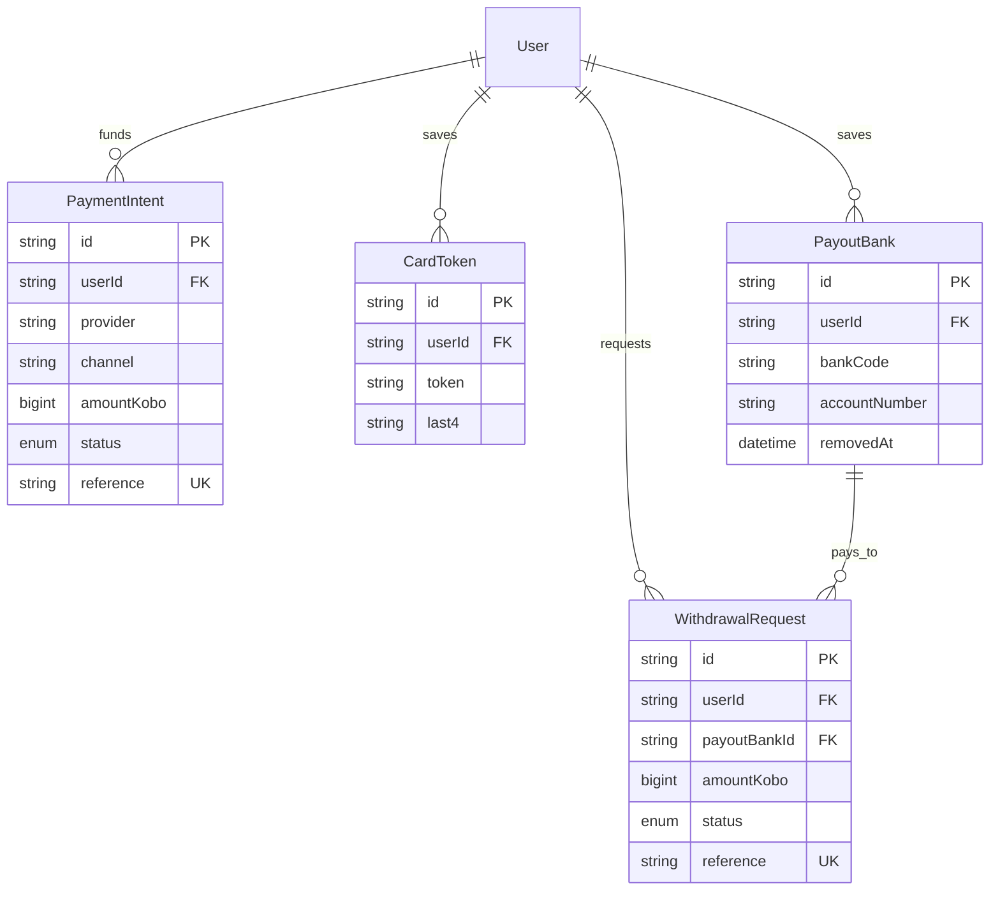
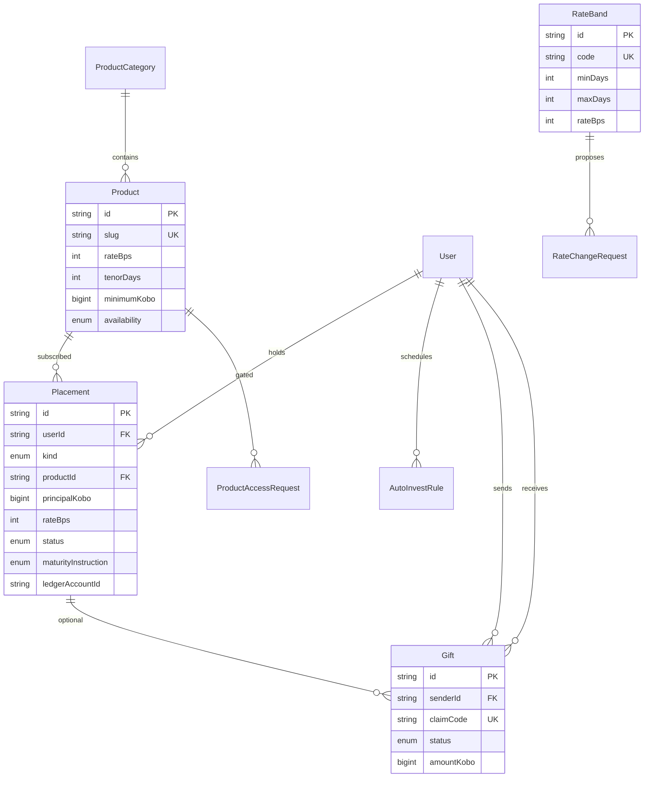
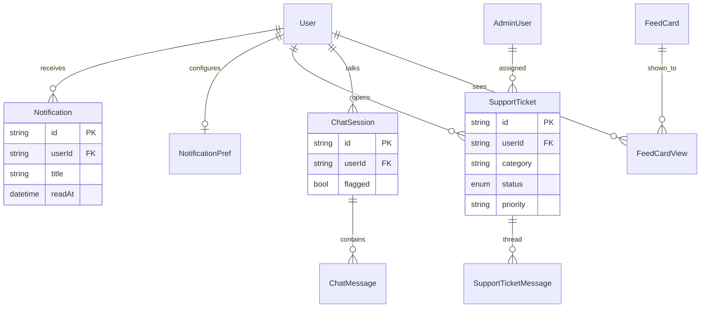
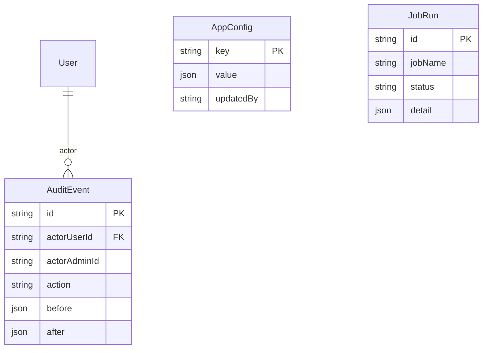
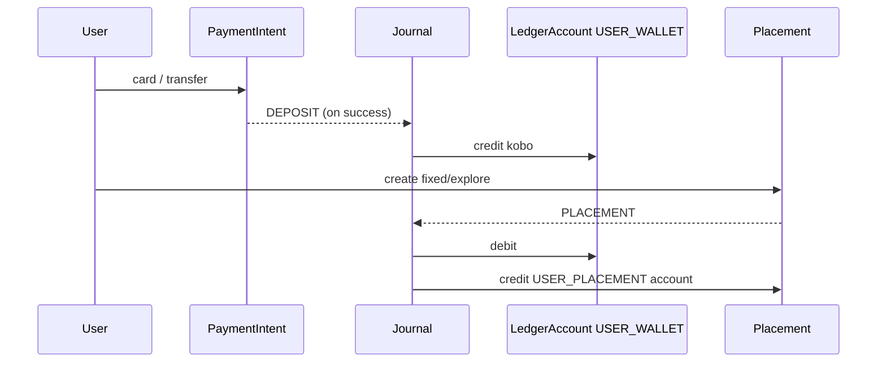

# Kipit database

**Engine:** PostgreSQL  
**ORM:** Prisma (`kipit-api/prisma/schema.prisma`)  
**Connection:** `DATABASE_URL`

Money is stored as **kobo** (`BigInt`). IDs are **cuid** strings unless noted.

---

## High-level map

---

## 1. Users, auth, KYC

A customer is one `User`. Login uses hashed password + OTP + refresh `Session`. KYC lives on `KycProfile` (1:1). Admins are a separate table (`AdminUser`), not the same as customers.

**Enums (identity)**

| Enum | Values |
|---|---|
| `KycTier` | `TIER_0`, `TIER_1`, `TIER_2` |
| `KycCaseStatus` | `NOT_STARTED`, `IN_PROGRESS`, `PENDING_REVIEW`, `APPROVED`, `REJECTED` |
| `OtpPurpose` | `SIGNUP`, `LOGIN`, `PASSWORD_RESET`, `PIN_RESET`, `ADMIN_LOGIN` |
| `AccountType` | `PERSONAL`, `BUSINESS` |
| `AdminRole` | `SUPER`, `GLOBAL`, `COMPLIANCE`, `OPERATIONS`, `MARKETING`, `FINANCE`, `SUPPORT`, `READ_ONLY` |

---

## 2. Ledger (source of truth for balances)

Balances are **not** stored only on placements. Each wallet / call / placement has a `LedgerAccount`. Moves go through double-entry: one `JournalEntry` with two or more `JournalLine`s (positive = credit, negative = debit).

**Account types (`LedgerAccountType`)**

| Type | Who | Meaning |
|---|---|---|
| `USER_WALLET` | customer | Spendable wallet |
| `USER_CALL` | customer | Call account balance |
| `USER_PLACEMENT` | customer | One account per fixed/explore placement (`tag` distinguishes them) |
| `SYSTEM_CLEARING` | system | In/out rails (Monnify, Paystack, payouts) |
| `SYSTEM_INTEREST` | system | Interest expense |
| `SYSTEM_FEES` | system | Fees |
| `SYSTEM_SUSPENSE` | system | Holds / exceptions |

**Journal kinds:** `DEPOSIT`, `WITHDRAWAL`, `CALL_DEPOSIT`, `CALL_WITHDRAW`, `PLACEMENT`, `INTEREST`, `MATURITY`, `ADJUSTMENT`, `FEE`, `REFERRAL`

Unique per user account: `(userId, type, currency, tag)`.

---

## 3. Money in / money out

| Enum | Values |
|---|---|
| `PaymentStatus` | `PENDING`, `SUCCESS`, `FAILED` |
| `WithdrawalStatus` | `PROCESSING`, `SUCCESSFUL`, `DECLINED` |

`PayoutBank.removedAt` is a soft delete so old withdrawals keep their bank FK.

---

## 4. Rates, products, placements, gifts

| Enum | Values |
|---|---|
| `PlacementKind` | `CALL`, `FIXED`, `EXPLORE` |
| `PlacementStatus` | `ACTIVE`, `MATURED`, `CLOSED` |
| `MaturityInstruction` | `WALLET`, `ROLLOVER`, `PAYOUT` |
| `ProductAvailability` | `OPEN`, `CLOSING`, `CLOSED`, `COMING_SOON` |
| `GiftStatus` | `PENDING`, `CLAIMED`, `CANCELLED`, `EXPIRED` |
| `RateChangeStatus` | `PENDING`, `APPROVED`, `REJECTED` |

Rates are **basis points** (`rateBps`). Maker-checker rate edits go through `RateChangeRequest` (`appliedAt` is when they actually hit `RateBand`).

---

## 5. Notifications, support, chat, content

`LearnArticle` and `FeedCard` are CMS-style tables (no user FK except `FeedCardView`).

---

## 6. Ops / config / audit

| Table | Role |
|---|---|
| `AppConfig` | Key/value JSON (`key` PK) — limits, fees, cutoffs, maintenance, flags |
| `JobRun` | Worker job history |
| `SignupFunnelEvent` | Incomplete signup analytics |
| `AuditEvent` | Who did what (`actorUserId` or `actorAdminId`) |

---

## Tables (quick index)

**Identity:** `User`, `Session`, `OtpChallenge`, `PushDevice`, `ConsentAcceptance`  
**KYC:** `KycProfile`  
**Admin:** `AdminUser`, `AdminSession`  
**Ledger:** `LedgerAccount`, `JournalEntry`, `JournalLine`  
**Rails:** `PaymentIntent`, `WithdrawalRequest`, `PayoutBank`, `CardToken`  
**Invest:** `RateBand`, `RateChangeRequest`, `ProductCategory`, `Product`, `ProductAccessRequest`, `Placement`, `AutoInvestRule`, `Gift`  
**Comms:** `Notification`, `NotificationPref`, `SupportTicket`, `SupportTicketMessage`, `ChatSession`, `ChatMessage`  
**Content:** `LearnArticle`, `FeedCard`, `FeedCardView`  
**Ops:** `AppConfig`, `JobRun`, `SignupFunnelEvent`, `AuditEvent`

---

## Typical money path

---

Schema source of truth: [`prisma/schema.prisma`](../prisma/schema.prisma). Migrations live in `prisma/migrations/`.
