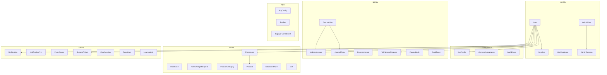
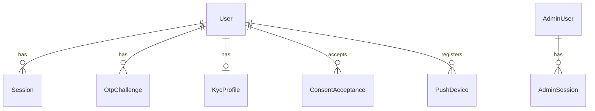
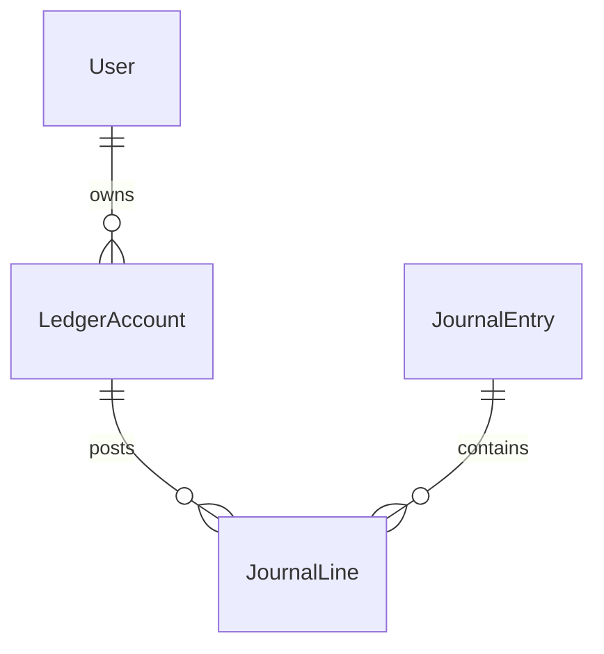
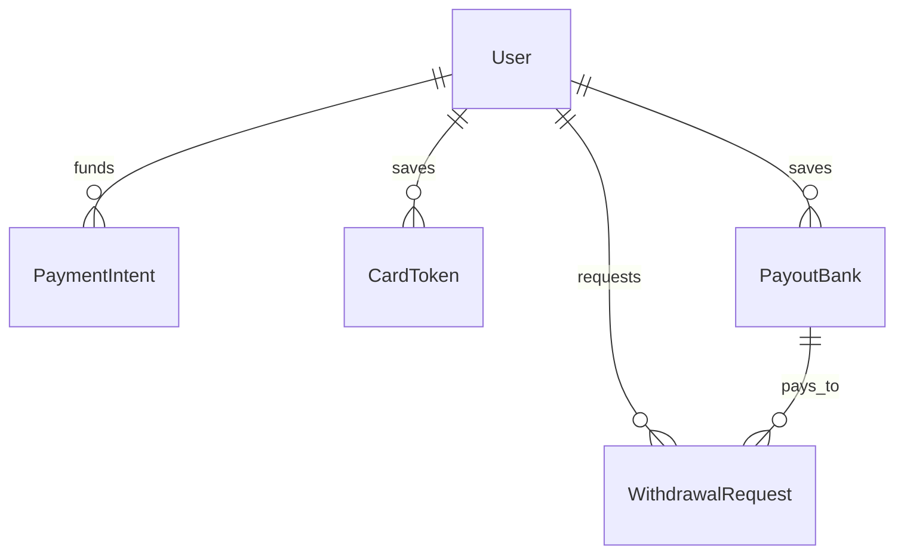
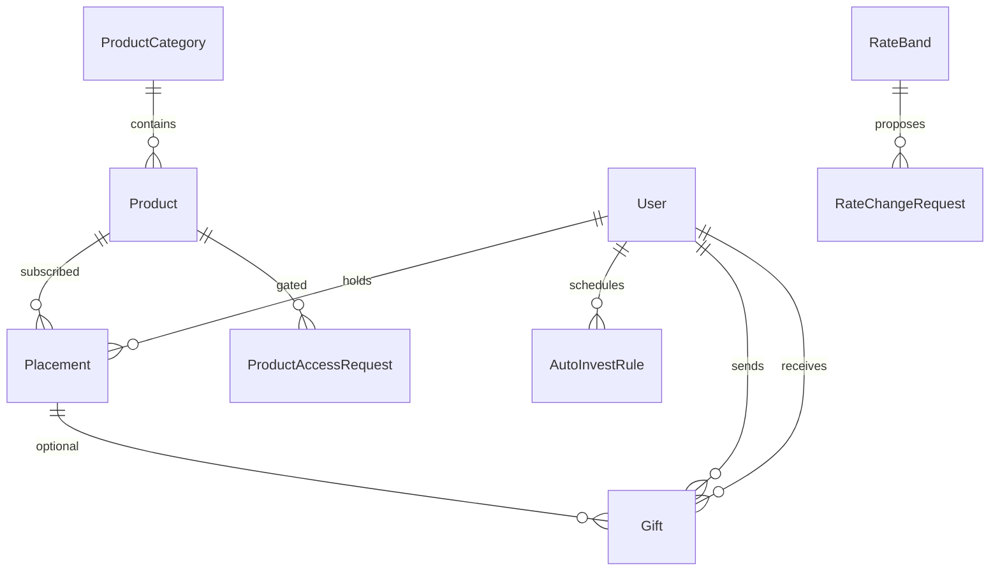
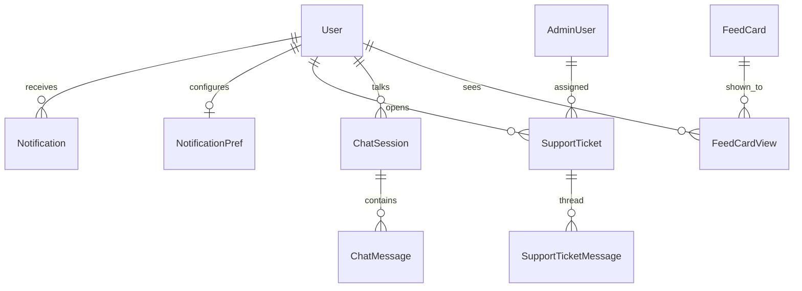
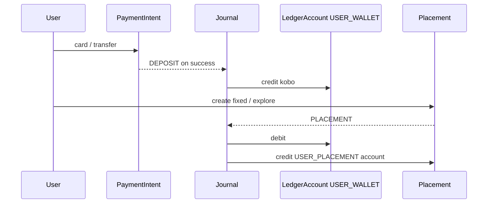

# Kipit database

**Engine:** PostgreSQL  
**ORM:** Prisma (`kipit-api/prisma/schema.prisma`)  
**Connection:** `DATABASE_URL`

Money is stored as **kobo** (`BigInt`). IDs are **cuid** strings unless noted (`AppConfig.key` is a string PK).  
Delete rule: customer children usually **cascade** when the `User` is deleted. Ticket assignee uses **SetNull**. `JournalLine` → `LedgerAccount` does **not** cascade (account must stay while lines exist).

---

## How tables relate (cardinality)

| From | To | Relation | FK / unique | On delete |
|---|---|---|---|---|
| `User` | `Session` | 1 → many | `Session.userId` | Cascade |
| `User` | `OtpChallenge` | 1 → many (optional user) | `OtpChallenge.userId` nullable | Cascade |
| `User` | `KycProfile` | 1 → 0..1 | `KycProfile.userId` **unique** | Cascade |
| `User` | `NotificationPref` | 1 → 0..1 | `NotificationPref.userId` **unique** | Cascade |
| `User` | `LedgerAccount` | 1 → many | `LedgerAccount.userId` nullable (system accounts have none) | Cascade |
| `User` | `Placement` | 1 → many | `Placement.userId` | Cascade |
| `User` | `PayoutBank` | 1 → many | `PayoutBank.userId` | Cascade |
| `User` | `CardToken` | 1 → many | `CardToken.userId` | Cascade |
| `User` | `PaymentIntent` | 1 → many | `PaymentIntent.userId` | Cascade |
| `User` | `WithdrawalRequest` | 1 → many | `WithdrawalRequest.userId` | Cascade |
| `User` | `Gift` (sent) | 1 → many | `Gift.senderId` | Restrict (no cascade on sender) |
| `User` | `Gift` (received) | 1 → many | `Gift.recipientId` nullable | Restrict |
| `User` | `Notification` | 1 → many | `Notification.userId` | Cascade |
| `User` | `PushDevice` | 1 → many | `PushDevice.userId` | Cascade |
| `User` | `SupportTicket` | 1 → many | `SupportTicket.userId` | Cascade |
| `User` | `ChatSession` | 1 → many | `ChatSession.userId` | Cascade |
| `User` | `AutoInvestRule` | 1 → many | `AutoInvestRule.userId` | Cascade |
| `User` | `ConsentAcceptance` | 1 → many | `ConsentAcceptance.userId` | Cascade |
| `User` | `FeedCardView` | 1 → many | `FeedCardView.userId` | Cascade |
| `User` | `AuditEvent` | 1 → many | `AuditEvent.actorUserId` nullable | Restrict |
| `PayoutBank` | `WithdrawalRequest` | 1 → many | `WithdrawalRequest.payoutBankId` | Restrict |
| `ProductCategory` | `Product` | 1 → many | `Product.categoryId` | Restrict |
| `Product` | `Placement` | 1 → many | `Placement.productId` nullable | Restrict |
| `Product` | `ProductAccessRequest` | 1 → many | `ProductAccessRequest.productId` | Restrict |
| `Placement` | `Gift` | 1 → many | `Gift.placementId` nullable | Restrict |
| `RateBand` | `RateChangeRequest` | 1 → many | `RateChangeRequest.bandId` | Restrict |
| `LedgerAccount` | `JournalLine` | 1 → many | `JournalLine.accountId` | Restrict |
| `JournalEntry` | `JournalLine` | 1 → many | `JournalLine.entryId` | Cascade |
| `SupportTicket` | `SupportTicketMessage` | 1 → many | `SupportTicketMessage.ticketId` | Cascade |
| `AdminUser` | `AdminSession` | 1 → many | `AdminSession.adminId` | Cascade |
| `AdminUser` | `SupportTicket` | 1 → many (assignee) | `SupportTicket.assigneeAdminId` nullable | SetNull |
| `ChatSession` | `ChatMessage` | 1 → many | `ChatMessage.sessionId` | Cascade |
| `FeedCard` | `FeedCardView` | 1 → many | `FeedCardView.cardId` | Cascade |

**No FK (standalone / loosely linked)**

| Table | Linked by | Notes |
|---|---|---|
| `Placement.ledgerAccountId` | string, not a Prisma relation | Should match a `LedgerAccount` of type `USER_PLACEMENT` |
| `User.referredBy` | string, not a Prisma relation | Other user’s `referralCode` |
| `User.onboardedByAdminId` | string, not a Prisma relation | Admin who created the account |
| `KycProfile.reviewedByAdminId` | string | Reviewing admin |
| `RateChangeRequest.makerAdminId` / `checkerAdminId` | strings | Admin maker-checker |
| `WithdrawalRequest.processedByAdminId` | string | Admin who approved/declined |
| `AppConfig.updatedBy` | string | Admin id |
| `AuditEvent.actorAdminId` | string, not a Prisma relation | Admin actor |
| `JobRun`, `SignupFunnelEvent`, `LearnArticle` | — | No parent table |

---

## Full relation diagram

```mermaid
erDiagram
  User ||--o{ Session : userId
  User ||--o{ OtpChallenge : userId
  User ||--o| KycProfile : userId
  User ||--o| NotificationPref : userId
  User ||--o{ PushDevice : userId
  User ||--o{ ConsentAcceptance : userId
  User ||--o{ LedgerAccount : userId
  User ||--o{ Placement : userId
  User ||--o{ PayoutBank : userId
  User ||--o{ CardToken : userId
  User ||--o{ PaymentIntent : userId
  User ||--o{ WithdrawalRequest : userId
  User ||--o{ Gift : senderId
  User ||--o{ Gift : recipientId
  User ||--o{ Notification : userId
  User ||--o{ SupportTicket : userId
  User ||--o{ ChatSession : userId
  User ||--o{ AutoInvestRule : userId
  User ||--o{ FeedCardView : userId
  User ||--o{ AuditEvent : actorUserId

  PayoutBank ||--o{ WithdrawalRequest : payoutBankId
  ProductCategory ||--o{ Product : categoryId
  Product ||--o{ Placement : productId
  Product ||--o{ ProductAccessRequest : productId
  Placement ||--o{ Gift : placementId
  RateBand ||--o{ RateChangeRequest : bandId

  LedgerAccount ||--o{ JournalLine : accountId
  JournalEntry ||--o{ JournalLine : entryId

  AdminUser ||--o{ AdminSession : adminId
  AdminUser ||--o{ SupportTicket : assigneeAdminId
  SupportTicket ||--o{ SupportTicketMessage : ticketId
  ChatSession ||--o{ ChatMessage : sessionId
  FeedCard ||--o{ FeedCardView : cardId
```

---

## Schema by domain

### 1. Users, auth, KYC

A customer is one `User`. Login uses hashed password + OTP + refresh `Session`. KYC lives on `KycProfile` (exactly one row when started). Admins are **`AdminUser`**, not customers.

**`User`** — customer account.

| Column | Type | Meaning |
|---|---|---|
| `id` | cuid PK | |
| `email`, `phone` | unique, optional | Login identifiers |
| `passwordHash`, `pinHash` | string | Auth + transaction PIN |
| `firstName`, `middleName`, `surname` | | Legal name |
| `accountType` | `PERSONAL` \| `BUSINESS` | |
| `businessName`, `businessRcNumber` | | Business KYC extras |
| `kycTier` | `TIER_0` / `_1` / `_2` | Cached tier (profile has the case) |
| `referralCode` | unique | Their invite code |
| `referredBy` | string | Other user’s code (logical, not FK) |
| `frozen`, `frozenReason` | | Admin freeze |
| `failedLoginCount`, `lockedUntil` | | Lockout |
| `monnifyAccountNo`, `monnifyBankName` | | Virtual account for transfers |
| `biometricsLogin`, `biometricsTxn` | bool | Device flags |
| `onboardedByAdminId` | string | Admin-created user |

**`Session`** — refresh token per device. `revokedAt` set = logged out.  
**`OtpChallenge`** — hashed OTP to `target` (email/phone) for `purpose`. May exist before `userId` is known (signup).  
**`KycProfile`** — 1:1 with user. BVN/NIN, selfie, Prembly provider status, reviewer.  
**`PushDevice`** — Expo/FCM token (`token` unique).  
**`ConsentAcceptance`** — `(userId, docKey)` versions of T&Cs.  
**`AdminUser`** — console login, `role`, encrypted TOTP (`totpSecretEnc` / `totpPendingEnc`).  
**`AdminSession`** — admin refresh token; `locked` for step-up.

**Enums**

| Enum | Values |
|---|---|
| `KycTier` | `TIER_0`, `TIER_1`, `TIER_2` |
| `KycCaseStatus` | `NOT_STARTED`, `IN_PROGRESS`, `PENDING_REVIEW`, `APPROVED`, `REJECTED` |
| `OtpPurpose` | `SIGNUP`, `LOGIN`, `PASSWORD_RESET`, `PIN_RESET`, `ADMIN_LOGIN` |
| `AccountType` | `PERSONAL`, `BUSINESS` |
| `AdminRole` | `SUPER`, `GLOBAL`, `COMPLIANCE`, `OPERATIONS`, `MARKETING`, `FINANCE`, `SUPPORT`, `READ_ONLY` |

---

### 2. Ledger (source of truth for balances)

Balances live on `LedgerAccount.balanceKobo`. Every movement is a `JournalEntry` with ≥2 `JournalLine`s (positive = credit, negative = debit). `Placement` also stores `principalKobo` / `accruedKobo` as product state; the cash still posts through the ledger.

**`LedgerAccount`**

| Column | Meaning |
|---|---|
| `userId` | Null for system accounts |
| `type` | Wallet / call / placement / system |
| `tag` | Distinguishes many `USER_PLACEMENT` rows; `"default"` for wallet/call |
| `currency` | Default `NGN` |
| `balanceKobo` | Cached balance |

Unique: `(userId, type, currency, tag)`.

**`JournalEntry`** — header: `kind`, unique `reference`, optional `idempotencyKey`, `metadata` JSON.  
**`JournalLine`** — `entryId` + `accountId` + `amountKobo`. Deleting an entry cascades lines; deleting an account does not.

**Account types**

| Type | Who | Meaning |
|---|---|---|
| `USER_WALLET` | customer | Spendable wallet |
| `USER_CALL` | customer | Call account |
| `USER_PLACEMENT` | customer | One per fixed/explore plan (`tag`) |
| `SYSTEM_CLEARING` | system | In/out rails |
| `SYSTEM_INTEREST` | system | Interest expense |
| `SYSTEM_FEES` | system | Fees |
| `SYSTEM_SUSPENSE` | system | Holds / exceptions |

**`JournalKind`:** `DEPOSIT`, `WITHDRAWAL`, `CALL_DEPOSIT`, `CALL_WITHDRAW`, `PLACEMENT`, `INTEREST`, `MATURITY`, `ADJUSTMENT`, `FEE`, `REFERRAL`

---

### 3. Money in / money out

**`PaymentIntent`** — inbound (Paystack/Monnify). `channel` e.g. card vs transfer. Status `PENDING` → `SUCCESS` / `FAILED`. Success posts a `DEPOSIT` journal.  
**`CardToken`** — saved card (`provider` default `paystack`).  
**`PayoutBank`** — NUBAN. `removedAt` = soft delete so old withdrawals keep `payoutBankId`.  
**`WithdrawalRequest`** — `PROCESSING` → `SUCCESSFUL` / `DECLINED`. `processedByAdminId` is a loose admin id.

| Enum | Values |
|---|---|
| `PaymentStatus` | `PENDING`, `SUCCESS`, `FAILED` |
| `WithdrawalStatus` | `PROCESSING`, `SUCCESSFUL`, `DECLINED` |

---

### 4. Rates, products, placements, gifts

**`RateBand`** — tenor window (`minDays`/`maxDays`) and live `rateBps`.  
**`RateChangeRequest`** — maker-checker. `appliedAt` is when `RateBand` actually updates. `makerAdminId` / `checkerAdminId` are loose admin ids.  
**`ProductCategory` / `Product`** — Explore catalogue. `details` JSON (about, risks, FAQs).  
**`ProductAccessRequest`** — waitlist / large-ticket ask (`userId` stored, no Prisma User relation).  
**`Placement`** — live holding: `kind` CALL / FIXED / EXPLORE. `productId` set for Explore. `ledgerAccountId` is the matching `USER_PLACEMENT` account (logical FK). `maturityInstruction`: `WALLET` | `ROLLOVER` | `PAYOUT`.  
**`AutoInvestRule`** — recurring top-up; `nextRunAt` for the worker.  
**`Gift`** — sender always; recipient user/phone/email until claimed. `claimCode` unique. Placement created on claim.

| Enum | Values |
|---|---|
| `PlacementKind` | `CALL`, `FIXED`, `EXPLORE` |
| `PlacementStatus` | `ACTIVE`, `MATURED`, `CLOSED` |
| `MaturityInstruction` | `WALLET`, `ROLLOVER`, `PAYOUT` |
| `ProductAvailability` | `OPEN`, `CLOSING`, `CLOSED`, `COMING_SOON` |
| `GiftStatus` | `PENDING`, `CLAIMED`, `CANCELLED`, `EXPIRED` |
| `RateChangeStatus` | `PENDING`, `APPROVED`, `REJECTED` |

Rates are **basis points** (`100 bps` = 1%).

---

### 5. Notifications, support, chat, content

**`Notification`** — in-app inbox (`readAt` null = unread).  
**`NotificationPref`** — 1:1 email/push toggles.  
**`SupportTicket`** + **`SupportTicketMessage`** — thread; `author` is `USER` | `SUPPORT` | `SYSTEM`. Assignee → `AdminUser` (SetNull).  
**`ChatSession` / `ChatMessage`** — Ask AI; `blocks` JSON for rich replies.  
**`FeedCard` / `FeedCardView`** — home cards; unique `(cardId, userId)` so each account is sent once.  
**`LearnArticle`** — published Learn content; no FKs.

**`TicketStatus`:** `OPEN`, `IN_PROGRESS`, `RESOLVED`, `CLOSED`

---

### 6. Ops / config / audit

**`AppConfig`** — key/value JSON for limits, fees, cutoffs, maintenance, feature flags. PK is `key`.  
**`JobRun`** — worker history (`jobName`, `status`, `detail`).  
**`SignupFunnelEvent`** — incomplete signup steps.  
**`AuditEvent`** — `actorUserId` (FK) or `actorAdminId` (loose); `before`/`after` JSON.

---

## Table index

**Identity:** `User`, `Session`, `OtpChallenge`, `PushDevice`, `ConsentAcceptance`  
**KYC:** `KycProfile`  
**Admin:** `AdminUser`, `AdminSession`  
**Ledger:** `LedgerAccount`, `JournalEntry`, `JournalLine`  
**Rails:** `PaymentIntent`, `WithdrawalRequest`, `PayoutBank`, `CardToken`  
**Invest:** `RateBand`, `RateChangeRequest`, `ProductCategory`, `Product`, `ProductAccessRequest`, `Placement`, `AutoInvestRule`, `Gift`  
**Comms:** `Notification`, `NotificationPref`, `SupportTicket`, `SupportTicketMessage`, `ChatSession`, `ChatMessage`  
**Content:** `LearnArticle`, `FeedCard`, `FeedCardView`  
**Ops:** `AppConfig`, `JobRun`, `SignupFunnelEvent`, `AuditEvent`

---

## Typical money path

---

Schema source of truth: [`prisma/schema.prisma`](../prisma/schema.prisma). Migrations: `prisma/migrations/`.
